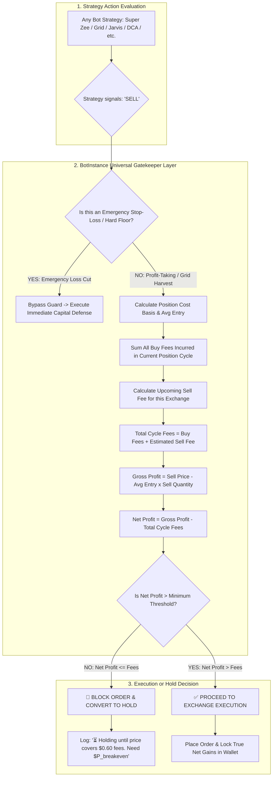

# Architecture & Implementation Plan: Universal Fee-Aware Net Profit Gatekeeper

Implement an automated **Fee-Aware Net Profit Gatekeeper** across **ALL bot types** (Super Zee, Jarvis, Grid, DCA, Smart Trade, Trailing, Martingale, Precision Grid) and **ALL exchanges** (Binance, CoinDCX, Pionex, Jupiter DEX, AngelOne, Upstox, Bybit, Kraken).

---

## 🎯 The Core Problem & Solution

### The Problem (Fee Drag / False Profits)
Bots frequently trigger profit-taking sells when price moves up by $+0.20\%$ to $+0.40\%$. While the gross price difference looks positive (e.g., $+\$0.50$), accumulated buy fees across multiple grid dips/DCA entries plus the upcoming sell fee (e.g., $\$0.60$ total) turn the trade into a **net negative loss ($-\$0.10$)**.

### The Solution: Universal Net Profit Guard
Before placing **ANY** profit-taking sell order, the execution engine dynamically computes:
$$\text{Net Profit} = \text{Gross Gain} - \left(\sum \text{Accumulated Cycle Buy Fees} + \text{Estimated Upcoming Sell Fee}\right)$$

* If $\mathbf{\text{Net Profit} \le \$0.00}$ (or below the user's minimum net gain buffer):
  * 🛑 **BLOCK THE SELL ORDER**.
  * ⏳ **Convert to HOLD & WAIT**: Keep holding the tokens until the market moves to the exact mathematical breakeven price where fees are covered and true net profit is realized.
* If $\mathbf{\text{Net Profit} > \text{Threshold}}$:
  * ✅ **EXECUTE THE SELL**: Secure guaranteed net profit in cash.

---

## 🏛️ System Architecture Workflow

---

## 📐 Detailed Mathematical Formula

Given:
* $Q_{\text{sell}}$: Quantity of base coins being sold.
* $P_{\text{sell}}$: Current market / trigger sell price.
* $P_{\text{avgEntry}}$: Weighted average entry price of current holdings.
* $\sum F_{\text{buy}}$: Total fees incurred across all buy orders that accumulated this holding.
* $r_{\text{exchange}}$: Taker/Maker fee rate for the target exchange (e.g., $0.10\%$ for Binance/CoinDCX, $0.05\%$ for Pionex, dynamic compute fee for Jupiter).

### 1. Calculation Steps
1. **Gross Position Profit**:
   $$\text{Gross Profit} = (P_{\text{sell}} - P_{\text{avgEntry}}) \times Q_{\text{sell}}$$

2. **Upcoming Sell Fee**:
   $$F_{\text{sell}} = (P_{\text{sell}} \times Q_{\text{sell}}) \times r_{\text{exchange}}$$

3. **Total Incurred Fees (Full Cycle)**:
   $$\text{Total Cycle Fees} = \sum F_{\text{buy}} + F_{\text{sell}}$$

4. **Net Profit Check**:
   $$\text{Net Profit} = \text{Gross Profit} - \text{Total Cycle Fees}$$

5. **Dynamic Minimum Breakeven Price**:
   $$P_{\text{breakeven}} = \frac{(P_{\text{avgEntry}} \times Q_{\text{sell}}) + \sum F_{\text{buy}} + \text{MinNetBuffer}}{Q_{\text{sell}} \times (1 - r_{\text{exchange}})}$$

---

## 🛠️ Implementation Plan Across Codebase

### 1. Universal Execution Layer (`backend/src/bots/BotInstance.ts`)
Since **`BotInstance` is the parent engine that executes every single bot in the system**, placing the gatekeeper here automatically protects:
* ✅ **Super Zee Bot**
* ✅ **JARVIS Bot**
* ✅ **Standard Grid & Precision Grid Bot**
* ✅ **Infinity Grid Bot**
* ✅ **DCA Bot**
* ✅ **Smart Trade Bot**
* ✅ **Trailing & Martingale Bots**
* ✅ **Rebalancing & Dynamic Grid Bots**

#### Changes in [`BotInstance.ts`](file:///c:/Users/shahidshaikh/POCs/AI-BDM/backend/src/bots/BotInstance.ts):
1. **Cycle Fee Accumulator**:
   * Add `currentCycleBuyFees: number` to `BotState`.
   * On every `BUY` fill in `processOrderFill()`, add `order.fee` to `currentCycleBuyFees`.
   * When holdings reach 0 (full cycle liquidated), reset `currentCycleBuyFees = 0`.
2. **Pre-Sell Net Profit Gatekeeper in `executeAction()` / `placeOrder()`**:
   * Before sending any `SELL` order to the exchange, check if the action is a profit harvest (i.e. not an emergency floor stop).
   * Evaluate $\text{Net Profit} = \text{Gross Profit} - (\text{currentCycleBuyFees} + \text{estimatedSellFee})$.
   * If $\text{Net Profit} \le \text{minBuffer}$:
     * Skip placing the order.
     * Log:
       `⏳ [Fee-Aware Protection] Blocked SELL: Gross profit is +$0.50, but total cycle fees (4 buys + upcoming sell) are $0.60 (Net: -$0.10). Holding until price reaches $0.5284.`
3. **Emergency Stop-Loss Bypass**:
   * Allow explicit stop-loss liquidations (`reason.includes('Emergency Floor')` or `action.metadata?.isEmergencyStop`) to bypass the profit gatekeeper so capital is preserved when market structure breaks.

---

### 2. Exchange Fee Rate Registry (`backend/services/exchangeService.js`)
Provide an accurate fee rate lookup based on the exchange and pair:
* **Binance**: $0.10\%$ spot ($0.075\%$ with BNB)
* **CoinDCX**: $0.10\% – 0.20\%$ spot
* **Pionex**: $0.05\% – 0.10\%$ spot
* **Jupiter DEX**: Dynamic Solana priority gas $+$ pool swap fee ($\approx 0.10\%$)
* **AngelOne / Upstox**: Brokerage ($₹20$ or $0.03\%$) $+$ STT/statutory taxes
* Default fallback: $0.10\%$ ($0.0010$)

---

### 3. UI Configuration & Transparency (`BotDetail.jsx` & Telemetry)
* Display a **"🛡️ Fee-Aware Net Profit Protection: ACTIVE"** badge on running bots.
* In the live Bot Telemetry and Activity Logs:
  * Show both **Gross PnL** and **True Net PnL (After Fees)**.
  * Show the exact **Fee-Adjusted Breakeven Target**.

---

## 🛡️ Example Scenario (User's Exact Case)

1. **Trade 1 (Buy)**: $\$15$ bought (Fee: $\$0.015$)
2. **Trade 2 (Buy Dip)**: $\$15$ bought (Fee: $\$0.015$)
3. **Trade 3 (Buy Dip)**: $\$15$ bought (Fee: $\$0.015$)
4. **Trade 4 (Buy Dip)**: $\$15$ bought (Fee: $\$0.015$)
   * *Total Buy Fees Incurred so far*: $\mathbf{\$0.060}$
5. **Trade 5 (Strategy signals SELL at $+0.3\%$ rise)**:
   * Gross Gain: $\mathbf{+\$0.050}$
   * Upcoming Sell Fee: $\mathbf{\$0.015}$
   * Total Fees for this cycle: $\$0.060 + \$0.015 = \mathbf{\$0.075}$
   * Net Outcome if sold: $+\$0.050 - \$0.075 = \mathbf{-\$0.025 \text{ (Loss!)}}$
   * **Gatekeeper Action**: 🛑 **BLOCKED**. Bot refuses to sell at $+0.3\%$.
6. **Price rises to $+0.6\%$**:
   * Gross Gain: $\mathbf{+\$0.120}$
   * Total Fees: $\mathbf{\$0.075}$
   * Net Outcome: $+\$0.120 - \$0.075 = \mathbf{+\$0.045 \text{ (Guaranteed Profit!)}}$
   * **Gatekeeper Action**: ✅ **EXECUTED**. True profit locked into wallet.

---

## 📋 Verification Plan
1. **Unit Test Simulation**:
   * Simulate a 4-buy DCA accumulation with small $0.2\%$ grid price bounces.
   * Verify the bot suppresses sell orders when gross gain $<$ total cycle fees.
   * Verify the bot automatically fires the sell when price crosses the fee-adjusted breakeven target.
2. **Emergency Stop Override Test**:
   * Verify that if an emergency floor / stop loss is breached, the bot liquidates immediately without being trapped by the fee gatekeeper.
3. **Multi-Exchange Verification**:
   * Test calculation accuracy on Pionex, CoinDCX, Binance, and Jupiter.
